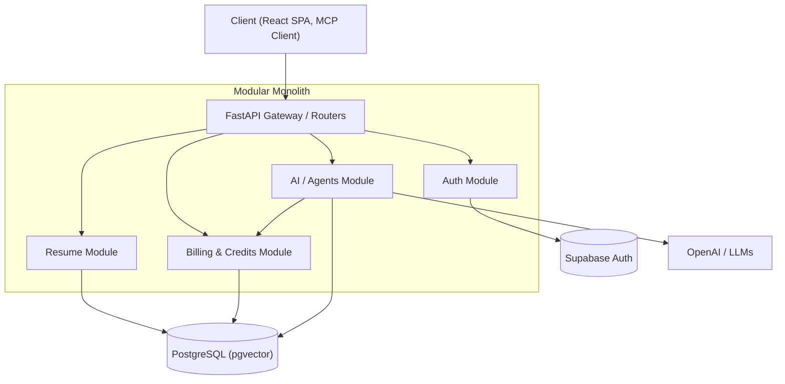

# Backend System Design & Architecture

This document details the High-Level Design (HLD), Low-Level Design (LLD), and Object-Oriented Programming (OOP) principles utilized in the Resume Chef FastAPI backend.

## 1. High-Level Design (HLD)

The backend follows a **Modular Monolith** architecture. While deployed as a single service to keep operations simple, internal modules are strictly isolated by domain, allowing easy extraction into microservices if scaling requires it.

### System Components



### Key HLD Decisions
- **Framework**: FastAPI (Python). Chosen for native async support, autogenerated OpenAPI docs, and Pydantic validation.
- **Database**: PostgreSQL (Supabase) extended with **pgvector**. The relational data model ensures ACID compliance for billing, while `pgvector` allows the same DB to act as a vector store for AI/Agents (e.g., semantic search of templates, ATS scoring features).
- **Dependency Direction**: The core domain logic depends on nothing. External layers (Web/API, DB) depend on the core domain.
- **Auto-Sync Mechanism**: Instead of backend compilation, the frontend handles PDF generation directly in the browser. The frontend auto-syncs any changes done in the resume to the backend every *X* seconds (configurable via settings and environment variables) using `PATCH /resumes/{id}`. This offloads compute to the client.

---

## 2. Low-Level Design (LLD) & Architectural Patterns

The codebase is structured using Domain-Driven Design (DDD) principles and layered architecture. 

### Layered Architecture Structure
Each domain (e.g., `resumes`, `billing`, `ai`) is structured as follows:
- **`router.py` (Controller Layer)**: Handles HTTP requests, parses inputs, and delegates to services.
- **`service.py` (Business Logic Layer)**: Contains core business rules. Operates independently of HTTP contexts.
- **`repository.py` (Data Access Layer)**: Abstracts database operations and queries.
- **`models.py` (Data Layer)**: SQLAlchemy ORM models.
- **`schemas.py` (DTOs)**: Pydantic models for request/response validation.

### Object-Oriented Programming (OOP) Concepts Applied

#### 1. Abstraction & The Strategy Pattern
To handle different MCP tools for various resume formats (e.g., retrieving or updating LaTeX vs JSON structure), we use the **Strategy Pattern**. This ensures the `McpService` is closed for modification but open for extension (Open-Closed Principle). Note that actual PDF compilation happens in the frontend, so the backend primarily deals with data formatting.

```python
from abc import ABC, abstractmethod

# The interface (Strategy)
class ResumeFormatter(ABC):
    @abstractmethod
    def format_for_mcp(self, resume_data: dict) -> str:
        """Formats resume data for the specific MCP tool."""
        pass

# Concrete Strategies
class LatexFormatter(ResumeFormatter):
    def format_for_mcp(self, resume_data: dict) -> str:
        # Extracts and structures LaTeX code
        pass

class WysiwygFormatter(ResumeFormatter):
    def format_for_mcp(self, resume_data: dict) -> str:
        # Returns the JSON tree in a readable format
        pass
```

The same pattern is utilized for **Payment Providers**, making it easy to swap Razorpay for Stripe later:
```python
class PaymentProvider(ABC):
    @abstractmethod
    async def create_order(self, amount: int, currency: str) -> OrderSession: 
        pass
    
    @abstractmethod
    async def verify_webhook(self, payload: dict, signature: str) -> WebhookEvent: 
        pass

class RazorpayProvider(PaymentProvider): ...
class StripeProvider(PaymentProvider): ...
```

#### 2. Dependency Injection (DI)
FastAPI's `Depends` system is used extensively to inject dependencies (like Repositories into Services, and Services into Routers). This decouples classes from their concrete dependencies and makes unit testing trivial by allowing mock injections.

```python
# Dependency definitions (Factory methods)
def get_resume_repository(db: Session = Depends(get_db)) -> ResumeRepository:
    return SqlAlchemyResumeRepository(db)

def get_resume_service(
    repo: ResumeRepository = Depends(get_resume_repository)
) -> ResumeService:
    return ResumeService(repo)

# Router (Controller Layer)
@router.post("/{resume_id}/compile")
async def compile_resume(
    resume_id: str,
    service: ResumeService = Depends(get_resume_service)
):
    return await service.compile_resume_to_pdf(resume_id)
```

#### 3. Single Responsibility Principle (SRP) & Composition
Each module and class has one primary reason to change. 
- The `CreditsService` solely handles ledger mathematics, verifying balances, and transactional integrity.
- The `AiService` handles LLM generation. It does *not* know how to deduct credits; it delegates to the `CreditsService` via composition.

#### 4. The Repository Pattern
To abstract the database engine, repositories implement an interface. The business logic (`Service`) interacts with the interface, not the database directly. This isolates ORM-specific code (e.g., SQLAlchemy syntax) from business rules.

```python
class ResumeRepository(ABC):
    @abstractmethod
    async def get_by_id(self, id: UUID) -> Resume: 
        pass
    
    @abstractmethod
    async def save(self, resume: Resume) -> Resume: 
        pass
```

#### 5. Factory Pattern
Used for instantiating complex objects, such as LangGraph agents based on the request type:

```python
class AgentFactory:
    @staticmethod
    def create_agent(agent_type: str) -> BaseAgent:
        if agent_type == 'chat':
            # Streaming LangGraph agent with FastMCP read_resume/patch_resume tools
            return ChatResumeAgent()
        elif agent_type == 'ats':
            # One-shot structured-output agent, no tool calls
            return AtsAgent()
        raise ValueError(f"Unknown agent type: {agent_type}")
```

#### 6. FastMCP Tool Design — Runtime Injection Pattern
The Chat Agent's tools (`read_resume`, `patch_resume`) never expose `resume_id` as an agent-fillable parameter. The backend injects it at request time from the authenticated user's session, binding the tool instance to the correct resume before handing it to the agent:

```python
# mcp_tools.py
from fastmcp import tool

@tool
async def read_resume(
    starting_line: int | None = None,
    no_of_lines: int | None = None,
    # resume_id is NOT in the tool signature — injected by the caller
    _resume_id: str = "",  # populated at runtime
) -> str:
    """
    Returns resume content with 1-indexed line numbers.
    If no params given, returns the full file.
    Partial reads include a footer: [Lines X to Y of N total lines].
    """
    ...

@tool
async def patch_resume(
    patches: list[dict],  # [{"from": int, "to": int, "content": str}]
    _resume_id: str = "",  # populated at runtime
) -> dict:
    """
    Applies ordered patches. Line numbers always refer to the original file.
    Best-effort: succeeded patches are committed, failed ones are reported back.
    Agent must not send overlapping ranges.
    """
    ...
```

See [docs/AGENTS_DESIGN.md](AGENTS_DESIGN.md) for the full tool contract and patch semantics.

---

## 3. Core Interactions & Sequences

### Example: AI Chat Flow with Credits (Cross-Domain Interaction)

This demonstrates how modules interact securely and transactionally.

1. **Router (`POST /ai/chat`)** receives the HTTP request.
2. **Router** receives injected instances of `AiService` and `CreditsService`.
3. **Router** instructs `CreditsService.reserve(user_id, amount=1, type="chat_message")`.
   - If credits are insufficient, an exception is thrown and an HTTP `402 Payment Required` is returned to the user.
4. If successful, **Router** calls `AiService.generate_reply(prompt)`.
   - `AiService` uses the **Factory Pattern** (`AgentFactory.create_agent('chat')`) to instantiate the correct LangGraph agent.
   - The LLM executes and returns the response.
5. **Router** instructs `CreditsService.settle(user_id, type="chat_message")`.
   - The ledger transaction is finalized in the database (append-only commit).
6. **Router** returns the HTTP response.

### Example: Resume Auto-Sync Flow

1. **Frontend** runs a timer (e.g., every 5 seconds) detecting changes.
2. **Frontend** sends `PATCH /resumes/{id}` with the updated `content_code` or `content_elements`.
3. **Router** receives the HTTP request and validates the JWT.
4. **Router** calls `ResumeService.update_resume(id, updates)`.
5. `ResumeService` uses `ResumeRepository.update(id, updates)` to save changes in PostgreSQL.
6. **Router** returns a 200 OK, keeping the client synchronized with the backend without blocking the user's editing experience.
