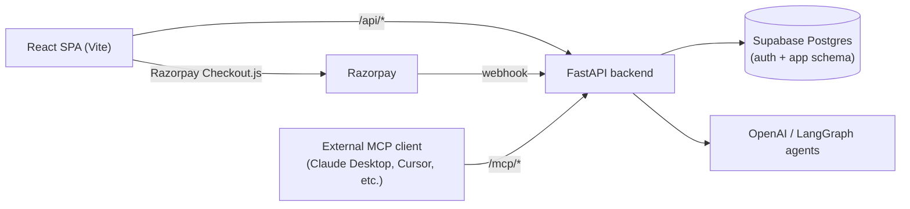
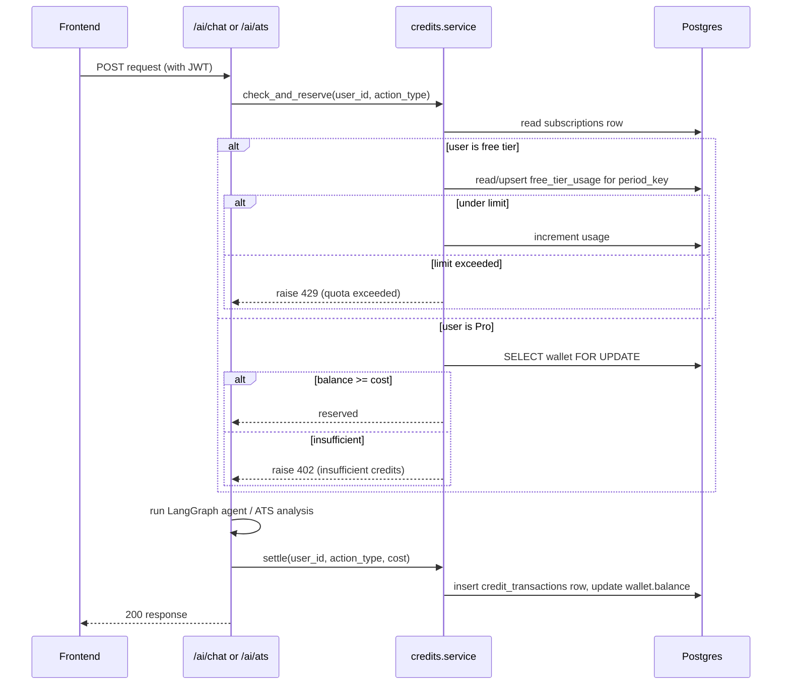
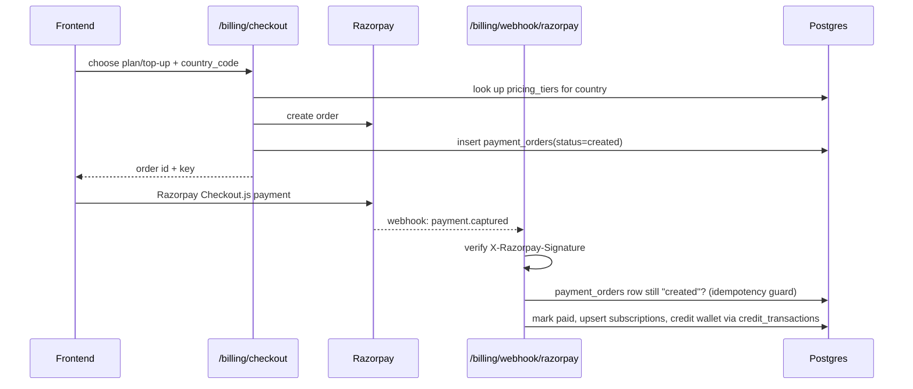

# System Design: Resumes, AI Agents, and Monetization

Status: Draft — architecture plan for implementing [docs/MONETIZATION.md](MONETIZATION.md) on top of the current codebase. Not yet implemented.

## Context from the codebase

- Backend (`backend/main.py`) currently only has `/health` and `/auth/me` (`backend/auth/router.py`). There are no AI endpoints, no resume persistence, and `database/models.py` has zero models defined.
- Frontend already calls `/api/ai/chat` and `/api/ai/ats` (`frontend/src/lib/api.js`), but since the backend doesn't implement them, every call fails and silently falls back to hardcoded mock responses (`mockChatReply`, `mockAtsAnalysis`). Resumes live only in React state (`frontend/src/hooks/useResume.jsx`) — nothing is persisted, and `MyResumesView.jsx` is a static stub.
- Auth is Supabase JWT-based (`backend/auth/dependencies.py` decodes the token locally with `supabase_jwt_secret`; no local `users` table). Since `DATABASE_URL` points at the same Postgres instance Supabase Auth uses, app tables can foreign-key directly to `auth.users(id)` without a mirror table.
- `pyproject.toml` already has `langchain`, `langgraph`, `deepagents`, `openai`, `ddgs` — the two agent surfaces in the UI (`AgentPanel.jsx`: "Resume Agent" = chat, "ATS Agent" = score checker) are clearly meant to be built as LangGraph/deepagents-based agents, not raw completion calls.

## Architecture overview

Everything stays inside the existing FastAPI app (MCP included) — new routers are added as sibling packages to `backend/auth/`, keeping one deployable service.

## Data model

All new tables live in `backend/database/models.py`. `user_id` columns are `UUID` foreign keys to `auth.users(id)` (no mirror table needed since it's the same Postgres instance).

- `resumes`: id, user_id, title, latex_code, elements (JSON), template_id, job_description, is_archived, created_at, updated_at
- `subscriptions`: user_id (PK), plan (`free`/`monthly`/`annual`), status, current_period_end, provider, provider_subscription_id, country_code
- `pricing_tiers`: id, country_code, currency, monthly_price_minor, annual_price_minor, monthly_credits (amounts stored in minor units — paise/cents — to avoid float rounding)
- `wallets`: user_id (PK), balance, updated_at
- `credit_transactions`: id, user_id, delta, balance_after, action_type (`subscription_grant`/`topup`/`chat_message`/`ats_check`/`mcp_call`), reference_id, metadata (JSON), created_at — append-only ledger, indexed on `(user_id, created_at)`
- `free_tier_usage`: (user_id, period_key) composite PK, chat_messages_used, ats_checks_used — `period_key` is a date/month string so resets are just a new row
- `payment_orders`: id, user_id, provider, provider_order_id (unique), amount_minor, currency, credits_granted, status (`created`/`paid`/`failed`), created_at — makes the Razorpay webhook idempotent
- `mcp_tokens`: id, user_id, token_hash, name, last_used_at, revoked_at — long-lived tokens for external agents, since Supabase JWTs aren't practical for third-party MCP clients

## Backend module layout (mirrors the existing `auth/` package pattern)

- `backend/resumes/` — `router.py` (CRUD), `schemas.py`, `service.py`
- `backend/ai/` — `router.py` (`POST /ai/chat`, `POST /ai/ats`), `agents.py` (LangGraph/deepagents definitions for the Resume Agent and ATS Agent)
- `backend/credits/` — `service.py` with `get_balance`, `check_and_reserve(user_id, action_type)`, `settle(user_id, action_type, cost)`; this is the one place quota/credit logic lives
- `backend/billing/` — `router.py` (`POST /billing/checkout`, `POST /billing/webhook/razorpay`), `providers/razorpay.py` implementing a small `PaymentProvider` protocol (`create_order`, `verify_webhook`, `parse_event`) so Stripe/Paddle can be dropped in later without touching the router
- `backend/mcp/` — MCP server mounted at `/mcp`, tools for `list_resumes`/`get_resume`/`update_resume_section`/`run_ats_check`, token auth in `mcp/auth.py`

## Quota/credit enforcement flow

Debit only happens **after** a successful AI call (not before), so failed LLM calls never cost the user credits. The `wallets.balance` update and `credit_transactions` insert happen in one DB transaction to keep the ledger and the cached balance consistent.

## Razorpay flow (MVP, provider-agnostic interface for later Stripe/Paddle)

## MCP server

- Mounted at `/mcp` in the same FastAPI app; tools operate on the same `resumes`/`credits` services as the REST routes, so behavior stays consistent between the web app and external agents.
- Auth via `mcp_tokens` (opaque token, hashed at rest, generated from a new "Developer / MCP" section in `SettingsView.jsx`), not the Supabase JWT.
- MCP calls are a free Pro perk (rate-limited, not credit-metered) as long as they only read/write resume data. If a future MCP tool triggers an LLM call, route it through the same `credits.service` as `/ai/chat`.

## Frontend changes required

- `frontend/src/lib/api.js`: add `listResumes`/`saveResume`/`deleteResume`, `getWalletBalance`, `createCheckout`, remove the mock fallbacks once real endpoints exist (or keep them only as an offline dev fallback).
- `MyResumesView.jsx`: wire to real resume CRUD, show the resume-count cap and an upgrade prompt when hit.
- `AiChatWidget.jsx` / `AtsPanel.jsx`: handle `402`/`429` responses with an upgrade-or-watch-an-ad prompt instead of a generic error.
- New "Billing" section in `SettingsView.jsx`: current plan, wallet balance, Razorpay Checkout.js integration, transaction history.

## Ads

- Static banner is purely a frontend integration (e.g. an ad network script placed in `MyResumesView.jsx`'s empty state / a sidebar slot).
- Rewarded ads need one small backend endpoint (e.g. `POST /free-usage/reward`) that verifies the ad network's server-side reward callback before incrementing that user's `free_tier_usage` allowance — never trust a client-side "ad finished" event alone, or it's trivially spoofable.

## Suggested build phases

1. Resume persistence + real AI chat/ATS endpoints (LangGraph agents), no monetization gating yet — unblocks everything else and fixes the current mock-only state.
2. `wallets` / `credit_transactions` / `subscriptions` / `free_tier_usage` tables + the `credits.service` quota dependency wired onto the Phase 1 endpoints.
3. Razorpay checkout + webhook + `pricing_tiers`, end-to-end Pro upgrade flow.
4. MCP server + token management UI.
5. Ads (static banner, then rewarded-ad-for-credit).
